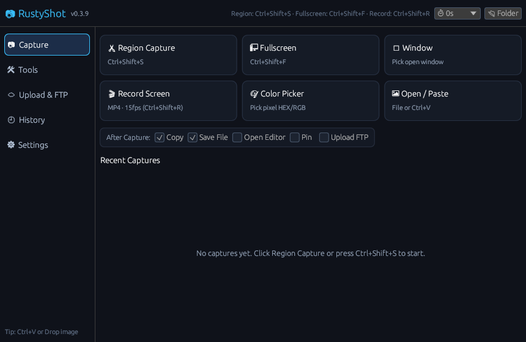

<p align="center">
  
</p>

# RustyShot

**RustyShot** là phần mềm chụp ảnh, quay màn hình và chú thích đa nền tảng (Windows, Linux X11/Wayland, macOS) viết bằng **Rust**, gọn nhẹ, 100% portable (chỉ 1 file thực thi duy nhất, không cần cài đặt).

**Tác giả:** Long kakaka (longanhvn)

## Giao diện ứng dụng



## Tính năng chính

- **Chụp ảnh màn hình đa chế độ:**
  - Chụp vùng chọn (`Ctrl+Shift+S`) với kính lúp 11×11, thước căn dòng (crosshair), thanh công cụ nổi kích thước lớn ở cạnh trên sau khi chọn vùng, giữ `Shift` khóa tỉ lệ vuông, phím mũi tên tinh chỉnh `1px` / `10px`, 8 điểm kéo kích thước, tự động bắt khung cửa sổ khi rê chuột.
  - Chụp toàn màn hình (`Ctrl+Shift+F`), chụp theo cửa sổ, hẹn giờ chụp (`0s / 3s / 5s`).
  - Dán ảnh trực tiếp từ Clipboard (`Ctrl+V`) hoặc kéo thả file ảnh vào ứng dụng.
- **Trình chỉnh sửa & chú thích nhanh:**
  - 9 công cụ: Mũi tên, Khung chữ nhật, Hình tròn/Elip, Bút vẽ tay, Bút đánh dấu (Highlight), Đánh số thứ tự (Step badge), Văn bản, Làm mờ/Che thông tin (Pixelate), Cắt ảnh (Crop).
  - Hỗ trợ Undo/Redo, Zoom (`-` / `100%` / `+` / `Fit` / `Ctrl+Cuộn`), Xoay 90°, Lật ngang/dọc.
- **Ghim ảnh nổi (Pinned Shot):**
  - Ghim ảnh chụp lên trên các cửa sổ khác, hỗ trợ phóng to/thu nhỏ và chỉnh độ mờ (Opacity).
- **Quay màn hình (GIF / MP4):**
  - Phím tắt `Ctrl+Shift+R`, thanh điều khiển nổi khi đang quay.
- **Công cụ tiện ích & Upload:**
  - **Color Picker:** Lấy mã màu trên màn hình, tự động copy mã HEX và lưu bảng màu gần đây.
  - **FTP / FTPS Upload:** Hỗ trợ FTP thường và **FTPS (Explicit TLS)**, chấp nhận chứng chỉ tự ký, tự động upload sau khi chụp và copy link công khai.
- **100% Portable & Single Instance:**
  - Tự động lưu cấu hình và media ngay cạnh file chạy: `./data/RustyShot.json`, `./data/image/`, `./data/video/`.
  - Chỉ chạy 1 tiến trình duy nhất; thu gọn xuống khay hệ thống (System Tray) và khôi phục nhanh khi click icon Tray hoặc mở lại ứng dụng.

## Build từ mã nguồn

```bash
# Chạy / kiểm tra trên Linux
cargo clippy -- -D warnings
cargo test
cargo run --release

# Cross-compile Windows x64 Portable trên Linux/WSL
cargo build --release --target x86_64-pc-windows-gnu
x86_64-w64-mingw32-strip target/x86_64-pc-windows-gnu/release/rustyshot.exe
```

## License

MIT
